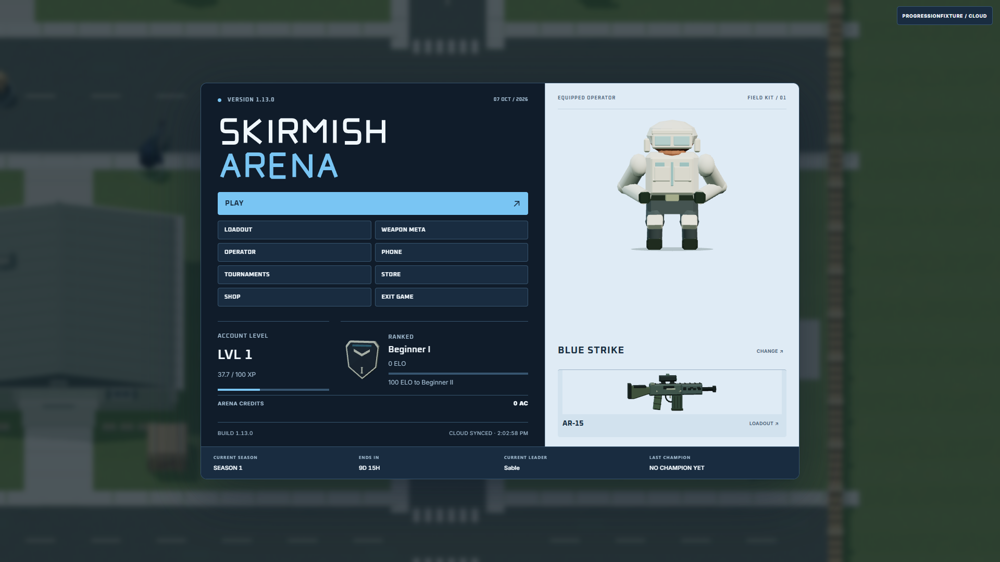

# Skirmish Arena

A tactical arena shooter with a persistent league of 50 bots. Pick a loadout, play a match, and watch rivalries, careers and seasons develop around you.

**1.15.0 — ARENA REFINED · Human multiplayer · Weapon Balance 9.0 · Beta**

[Download for Windows (64-bit)](https://github.com/nhicksenterprises2025-maker/skirmish-arena-official-game/releases/latest) — choose the Windows setup file from the latest published release.



## Install

1. Download the Windows installer above.
2. Run it, then open **Skirmish Arena** from your desktop or Start menu.
3. Press **Play**, create an account or sign in, and choose a mode.

The installer includes the game's required local runtime. You do not need Node, a terminal or a separately started game server to play. Windows WebView2 is required; setup handles it when needed. The current installer does not have a Windows publisher certificate.

For an existing installation, run the new installer over it. Accounts and save data stay outside the game files. Keep your recovery code and use **Settings → Account → Data Management** to export a backup before moving to another PC.

## The game

- **Human multiplayer.** Casual TDM, Deathmatch, Gun Game, Domination, Hardpoint, custom matches and eligible official tournament games share the existing combat simulation. Casual/custom/tournament slots may use eligible persistent bots. Ranked remains TDM and Deathmatch only.
- **Friends and parties.** Phone's Friends app supports requests, privacy and invitations. Ready your party in the lobby: up to five players in team queues or ten in Deathmatch.
- **Factions.** Create a social group with a curated emblem, invite friends or accept applications, and manage Owner, Officer and Member roles. Profiles and parties show its tag and logo. Factions grant no combat bonuses.
- **Match replays.** Open Replays from Profile to watch completed eligible matches, follow players and scrub the action. Storage limits keep recordings bounded; playback never awards progress.
- **Cosmetic collection.** Ten distinct operators, twelve profile icons, eight banners and six victory poses join the existing wardrobe and earned mastery badges. Premium operators cost 2,500 AC. Cosmetics never change combat or hitboxes; previews never grant ownership.
- **A league that remembers.** Fifty bots keep their careers, weapon familiarity, form and season history.
- **Three arenas.** Brightfield Blocks stays permanent. Foundry Crossing favors workshop flanks and close engagements; Relay Fields has longer lanes and covered crossings. Map pools, quick casual voting and custom selection use the same simulation.
- **Four background match slots.** Two TDM and two Deathmatch slots rotate fairly through the 50-bot roster. Switch matches, follow individual bots or use the tactical camera.
- **Fifteen weapons and cosmetic operators.** Inspect the 2.5D models, build a primary/sidearm loadout and follow the current Weapon Meta.
- **Account progression.** Earn XP through eligible matches and progress through Levels 1–50. Click Account Level to inspect current, completed and upcoming levels. Lifetime XP keeps accumulating at the cap.
- **Weapon mastery.** Each weapon has a separate Levels 1–10 track. Open mastery from Loadout to inspect combat progress, challenges and dimensional tier badges. Mastery awards cosmetic rewards; it adds no weapon buffs.
- **Tournaments and Phone.** Register teams, follow brackets, invite bots and inspect live scores and bot records. Phone retains Live Scores, Spectate, Bot Leaderboard and Bot Weapon Meta, and adds Friends and Factions.

Online matches resolve damage, kills, results and rewards on the shared game service. Everyone must connect to the same game address to meet. Public hosting is staged and has not been activated or verified. Local/shared-service tests do not mean the public game is already live.

## Playing and saving

Aim with the mouse; gameplay captures it and menus release it. Open **Settings → Game → Controls** for bindings and sensitivity. **Tab** shows the combat scoreboard and **F11** toggles fullscreen.

Previously authenticated accounts can use their cached world when the account connection is unavailable. The game shows **CLOUD OFFLINE — LOCAL MODE**, keeps saving locally and synchronizes when the connection returns. Human matchmaking and competitive rewards require a connection; offline practice awards no XP or Ranked rating. First-time login and account creation require a working account service. The desktop app starts its included local service automatically.

When the shared public service is activated, the trusted account migration preserves existing usernames, password credentials and progress. Sign in once at that address with your existing account; do not create a replacement account. The new address keeps its own authenticated cache after that first sign-in. The original local data remains retained.

Your username menu opens **Player Profile** and **Settings**. Settings has four tabs: **Game**, **Audio**, **Account** and **About**. Backups are under **Account → Data Management**. Profiles include accepted online results alongside historical careers. **Online Record** in the lobby shows the server-verified match ledger, which remains available from the local cache when offline.

**Chat / Voice** opens party chat and, in a match, match chat or team chat. Deathmatch has no team channel. Voice is off until you enable it; hold **V** to talk. Mute your microphone or another player, adjust individual volume, choose available devices, or disable voice. Blocked players cannot bypass blocks through invitations or party joining.

**Phone → Factions** opens membership, roster, applications and verified activity. Logo components and colors come from a curated builder; image uploads are unavailable. Ownership transfer and disbanding require explicit confirmation. Block invitations or report a faction/name/logo from its page. Offline inspection uses the last verified record; membership changes require a connection.

The [player guide](docs/PLAYER-GUIDE.md) covers modes, careers, seasons, tournaments, Phone and backups.

## Arena Refined

Build **1.15.0** retains all ten Arena Refined audits, the gameplay quality fixes, bot careers and Balance 9.0, and adds server-resolved human multiplayer. Mode entry still prepares the match for at least three seconds before its countdown. Phone keeps its four original apps and adds Friends; the retired bot conversation feature stays removed.

A $0.50 Polar Camo offer is available for Sandbox payment testing when its service is configured. Public real-money checkout remains unavailable. Returning from checkout does not grant credits or an appearance by itself; delivery requires verification.

Application version **1.15.0**, Weapon Balance **9.0**, and the AI/ruleset revisions are separate. Full historical notes remain available in **Settings → About** and [version.json](version.json).

The interface uses shared dark-green surfaces, readable tables and inspectable model stages. Click a dimensional ranked emblem to inspect Ranked Stats, the complete ladder, rating changes, season records and leaderboards. Account Level and competitive Rank have separate tracks. Combined Stats uses unique eligible casual, Ranked and official tournament records; custom sessions, custom tournaments and practice remain excluded. Ratios use the actual totals.

Configured Ranked rewards show Locked, Earned, Claimable or Claimed. Claims and equipped rewards persist through the account service; repeated requests cannot grant an item or credits twice. Only explicitly configured rewards appear. Season ratings carry forward unless a reset is configured; completed season records retain their final rank.

Weapon mastery uses verified damage, kills, headshot kills, active use and meaningful wins. Casual permanent modes, Ranked and official tournaments qualify; Custom, practice, custom tournaments, replay and debug do not. Equipped time cannot produce mastery XP without combat. Progress, challenges and cosmetic claims persist independently of account XP, competitive Rank and bot familiarity. Cached mastery remains readable offline; new awards and claims require the authoritative service.

Skirmish Challenge Tournament runs every three calendar days at 7:30 PM Eastern, with daylight saving. Check in during the first 90 seconds of each two-minute preparation block. Play all three quarterfinal and semifinal games and all five final games; total kills decide advancement, followed by team damage if tied. Event pages show the fixed schedule, connected bracket, tournament-only leaderboards and official history.

Balance 9.0 adds the semi-automatic FAL. Ranges use meters without changing the map's size or physical weapon behavior. Current-patch telemetry starts clean while lifetime records and previous patches remain available. The [player guide](docs/PLAYER-GUIDE.md) covers schedules, permanent no-show replacements, rewards and statistical eligibility.

## Source and builds

This repository contains the game, desktop launcher, account service, tests, runtime assets, editable Blender files and asset tools.

[Download source ZIP](https://github.com/nhicksenterprises2025-maker/skirmish-arena-official-game/archive/refs/heads/main.zip), or clone:

```sh
git clone https://github.com/nhicksenterprises2025-maker/skirmish-arena-official-game.git
```

See [Building from source](docs/BUILDING.md) for setup and tests. The large original audio library is a separate release download; it is needed only to rebuild audio, not to run or package the game. Personal saves, credentials, signing keys, dependencies and generated installers are kept out of Git.

Third-party notices are included in [the audio credits](assets/audio/LICENSES.json) and [the renderer license](vendor/THREE-LICENSE.txt), and [font licenses](assets/fonts/README.md).

## Problems and feedback

[Open an issue](https://github.com/nhicksenterprises2025-maker/skirmish-arena-official-game/issues) with your game build, Windows version, what happened and how to reproduce it. A screenshot or the first error from the startup log helps. Leave passwords, recovery codes and private save files out of public reports.
